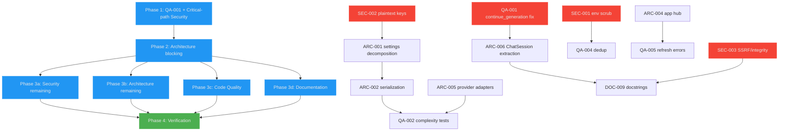

# Project Audit Report

> **Project**: parllama (PAR LLAMA)
> **Date**: 2026-10-15
> **Stack**: Python 3.12+ / Textual + Rich TUI / uv / ruff / pyright / pytest / par-ai-core
> **Audited by**: Claude Code Audit System (4 domain agents on the parsight graph index at HEAD `5d61187`)

---

## Executive Summary

Overall health is **Fair-Good**: no critical security vulnerabilities (`uv audit` clean, no hardcoded secrets, structural command-injection prevention, strong crypto vault), and genuine decomposition work is visible and tested. The single most critical finding is a correctness bug in `chat_session.continue_generation` (QA-001) that permanently deletes persisted messages and wedges the session busy flag when no model is selected. The highest systemic risks are a High-severity credential-exposure chain in the execution pipeline (SEC-001) and the `settings_manager.py` god module whose delegation layer plus hand-written flat-format mapper taxes every configuration change (ARC-001/ARC-002). Remediating the Critical and High items is an estimated 2-3 sprints; the codebase's strongest asset is its security layer (`SecureFileOperations`, `FileValidator`, `SecretsManager`) and behavior-driven test discipline.

### Issue Count by Severity

| Severity | Architecture | Security | Code Quality | Documentation | Total |
|----------|:-----------:|:--------:|:------------:|:-------------:|:-----:|
| 🔴 Critical | 0 | 0 | 1 | 0 | **1** |
| 🟠 High     | 6 | 1 | 1 | 3 | **11** |
| 🟡 Medium   | 4 | 2 | 3 | 5 | **14** |
| 🔵 Low      | 1 | 4 | 3 | 6 | **14** |
| **Total**   | **11** | **7** | **8** | **14** | **40** |

Deduplication notes: `settings_manager.py` god module was found by both Architecture and Code Quality (merged into ARC-001/ARC-002); provider-fetch complexity by both (merged into ARC-005); ChatSession streaming duplication by both (merged into ARC-006); dead code by both (merged into QA-003); cross-file duplication by both (merged into QA-004).

---

## 🔴 Critical Issues (Resolve Immediately)

### [QA-001] `continue_generation` early return deletes messages and wedges `_generating`
- **Area**: Code Quality
- **Location**: `src/parllama/chat_session.py:1030-1035` (unguarded return), `:1016` (flag set), `:1106-1107` (finally that never covers it)
- **Description**: The no-model guard `if not self._llm_config.model_name.strip(): ... return False` sits *before* the `try:` at line 1037, while `self._generating = True` was already set at 1016 and messages after the target were already deleted and persisted (`self.save()` at 1029). The `finally: self._generating = False` only attaches to the later try. The twin method `send_chat` (`:655-662`) places the same guard inside its try/finally — direct evidence of copy-drift.
- **Impact**: Editing an assistant message and continuing with no model selected (reachable: config reset, provider key removed) permanently deletes all following messages from disk AND leaves `is_generating` True, so every subsequent `continue_generation` returns False at the top guard until a successful `send_chat` resets the flag.
- **Remedy**: Move the no-model check above `self._generating = True` (before any mutation), or wrap the whole body so the finally covers the guard. Add a regression test: `continue_generation` with empty model name must leave `is_generating == False` and the message list unchanged. Safe to land independently and first; do not wait for ARC-006.

---

## 🟠 High Priority Issues

### [SEC-001] Executed LLM content inherits the full environment, including every provider API key and vault secret
- **Area**: Security
- **Location**: `src/parllama/execution/command_executor.py:210` (`env = os.environ.copy()`), fed by `src/parllama/secrets_manager.py:729` (`import_to_env`), `src/parllama/settings_manager.py:310-312` (`update_env`); result loop `src/parllama/coordinators/execution_coordinator.py:152` (`add_to_chat=True`)
- **Description**: Code run through an execution template (default allowlist includes `python`, `bash`, `sh`, `zsh`, `fish` — full interpreters, so the base-command allowlist is not restrictive) receives a copy of the parent environment containing all provider API keys and, when configured, `PARLLAMA_VAULT_KEY` itself. Execution stdout is added to the chat session and becomes LLM prompt context on the next turn.
- **Impact**: CWE-200/CWE-522. A prompt-injected attached document or web-fetched page makes the model emit a benign-looking code block; the user confirms execution; the code prints `os.environ`; secrets land in the transcript and a follow-up turn can exfiltrate them.
- **Remedy**: In `_execute_command`, strip credential-bearing variables from the child env (`*_API_KEY*`, `*TOKEN*`, `*SECRET*`, `*KEY*`, `PARLLAMA_VAULT_KEY`, `LANGCHAIN_API_KEY`) — the `LD_PRELOAD`-style scrub already there shows the pattern, extend it or invert to an allowlist. State in the confirmation dialog that the child inherits the user's environment.

### [ARC-001] `settings_manager.py` is a god module mixing four unrelated responsibilities behind ~830 lines of delegation boilerplate
- **Area**: Architecture (also found by Code Quality)
- **Location**: `src/parllama/settings_manager.py:434-1264` (delegation), `:1621` (image caching), `:171-235` (directory layout/migration)
- **Description**: 1,696 lines, 186 functions, fan-in 12, parsight risk Critical. The Settings class composes nested Pydantic groups but re-exposes every field as a flat property/setter pair "for backward compatibility" (~130 two-method pairs, half the file). On top of the config model it owns directory creation/migration, purge CLI flags, `os.environ` mutation, an atomic-write fallback, and `fetch_and_cache_image` (HTTP image download inside the settings module).
- **Impact**: Adding one setting is a 4-edit ritual (config group field, property+setter, `_apply_flat_data_to_settings` line, `apply_cli_args`) with silent-failure modes — forget the mapper line and the setting quietly reverts to default on next load. Highest-churn merge surface in the repo.
- **Remedy**: Delete the delegation layer and migrate the 42 consuming modules to `settings.<group>.<field>` (mechanical); move `fetch_and_cache_image` to a dedicated image-cache module; move directory layout/migration into a small `paths.py`. Coordinate with the open card "Expose file-validation settings in the Options view" (land or fold it first to avoid double churn).

### [ARC-002] Dual serialization format with a hand-written 235-line flat-to-nested mapper
- **Area**: Architecture (also found by Code Quality)
- **Location**: `src/parllama/settings_manager.py:1320-1554` (`_apply_flat_data_to_settings`, complexity 32), `:272-291` (`model_dump` flattening)
- **Description**: Settings are stored flat on disk but modeled nested in memory, bridged by a hand-maintained mapper with legacy migrations inlined (`starting_screen`→`starting_tab`, `disable_litellm_provider`, `last_chat_provider`). Nested Pydantic validation is bypassed on load (values set through delegation setters after ad hoc clamping).
- **Impact**: The single most complex function in the config path; any new field or rename must be mirrored exactly or user settings are silently dropped. Zero tests beneath it.
- **Remedy**: Serialize nested groups directly with a `schema_version` field and a one-time migration in the loader, letting Pydantic own round-tripping. If flat must stay, generate the mapping from a declarative `{flat_key -> (group, field)}` table shared by dump and load.

### [ARC-003] Eight module-level lazy singletons with import-order temporal coupling and import-time side effects
- **Area**: Architecture
- **Location**: `src/parllama/settings_manager.py:1596` (`__getattr__`), same pattern in `chat_manager.py:340`, `provider_manager.py:407`, `secrets_manager.py`, `memory_manager.py`, `ollama_data_manager.py`, `theme_manager.py`, `update_manager.py`; wiring `src/parllama/app.py:145-156`; trap documented in `src/parllama/__main__.py:18-21`, `src/parllama/message_sink.py:55`
- **Description**: Every manager is a module-level singleton via PEP 562 `__getattr__`. Any of the 42 modules importing `settings` at module level before `initialize_settings(get_args())` triggers full initialization with an empty `Namespace` — creating user data directories, loading settings.json, and writing it back as a side effect of an import. The codebase already works around this in two places with comments. `provider_manager` construction additionally runs `load_dotenv`. Inconsistency: `app.py:156` assigns `memory_manager._app` directly, bypassing the `set_app()` convention.
- **Impact**: Correctness depends on import order surviving refactors; a test or alternate entry point importing any widget module first silently reinitializes settings without CLI args and performs file I/O during collection.
- **Remedy**: Keep the singletons but make construction side-effect-free with an explicit `bootstrap()` at the single composition root (`__main__.run` already does this — extend to all entry points); replace module-level `from ... import settings` with lazy module references or function-local imports; give `memory_manager` a `set_app` for consistency.

### [ARC-004] The App remains a mandatory message hub — four-hop routing with manual field copying
- **Area**: Architecture
- **Location**: `src/parllama/app.py:537-619` (25+ `@on` handlers), `:485-496` (`post_message_all` special cases), `src/parllama/coordinators/session_event_router.py:55-59`
- **Description**: Cross-widget events travel widget/manager → `app.post_message` → App `@on` handler (`event.stop()`) → SessionEventRouter → `post_message_all` → `EventBus.broadcast` → subscribers. The coordinator extraction moved bodies out of `ParLlamaApp`, but every message still funnels through it, and most handlers are pure `stop() + delegate` boilerplate. `SessionEventRouter.chat_message` re-constructs `ChatMessage` by hand — a copy that silently drops any field added later.
- **Impact**: App is the top change-amplification point (betweenness 0.061, out-degree 66); the manual re-construction is a latent bug for the next field added to `ChatMessage`.
- **Remedy**: Let domain events broadcast to the `EventBus` directly at the source (managers already hold `MessageSink` app references); reserve App handlers for app-level concerns; forward the original event object instead of re-constructing; fold the `StatusMessage`/`PsMessage` special cases into the router or bus.

### [ARC-005] Provider model fetching is a complexity-37 if/elif chain — Open/Closed violation with per-branch drift and missing timeouts
- **Area**: Architecture (also found by Code Quality)
- **Location**: `src/parllama/provider_manager.py:117-212` (`_fetch_provider_model_list`)
- **Description**: One method branches per provider with inlined SDK construction, fetching, chat-mode filtering, and sorting repeated five times. The OPENAI branch guards `m.created is not None`; GROQ (`:169-175`) and ANTHROPIC (`:177-184`) sort unconditionally on `created`/`created_at` and would crash or mis-sort on None. LITELLM re-implements the request with raw `requests.get` and indexes `["data"]` unguarded. Several branches make network calls without the configured `settings.http.provider_model_request_timeout`.
- **Impact**: Highest-complexity function in the codebase; adding a provider widens the branch; drift is invisible because nothing is under test; timeout gaps can hang a refresh worker.
- **Remedy**: A registry `dict[LlmProvider, Callable]` of per-provider fetch adapters returning normalized `(id, created)` tuples plus one shared filter/sort path; thread `provider_model_request_timeout` into every client constructor.

### [ARC-006] `ChatSession` is a six-responsibility god class; streaming loop duplicated verbatim with `continue_generation`
- **Area**: Architecture (streaming duplication also found by Code Quality)
- **Location**: `src/parllama/chat_session.py:43-1172` (god class); duplication `:683-720` (`send_chat`) vs `:1044-1078` (`continue_generation`)
- **Description**: One class owns LLM-config facade properties, the streaming engine, token/cost accounting, memory injection, document budgeting, and persistence. The ~60-line streaming chunk loop is copy-identical between the two public methods (reasoning deltas, ttft, abort block, stats update, per-chunk emit) — the only difference is which message object receives content. QA-001 is the direct product of this duplication.
- **Impact**: Any fix to abort/stat/error streaming semantics must be applied twice and will half-miss (already has, once). Every chat feature grows this file.
- **Remedy**: Extract a `StreamController` (chunk assembly, stats, error handling) and a `SessionStore` (serialization); the private `_*` streaming helpers (lines 365-620) form the natural seam. Sequence with the in-flight attachment work — `send_chat`'s stream loop already carries `documents`/`doc_text_char_cap` plumbing; do not refactor concurrently with attachment fix-ups.

### [QA-002] The five most complex functions in the repo have zero direct tests
- **Area**: Code Quality
- **Location**: untested: `provider_manager.py:117` (ARC-005), `settings_manager.py:1320` (ARC-002), `prompt_utils/import_fabric.py:409` (`extract_zip`, 26), `ollama_data_manager.py:279` (24), `chat_session.py` `continue_generation` (23)
- **Description**: `tests/` (24 files) covers attachments, chat routing/notifications, file validation, secure file ops, secrets, message bus — but the settings deserializer, provider fetch, fabric ZIP extraction, and site-model refresh have no test files at all.
- **Impact**: The riskiest code (parsing untrusted JSON/ZIPs, network fan-out) is exactly the untested code; QA-001 lived in one of these gaps.
- **Remedy**: Prioritize: (1) regression test for QA-001; (2) `_apply_flat_data_to_settings` round-trip/legacy-key tests; (3) `extract_zip` fixture tests (zip-bomb and traversal cases — the validator has them, the extractor does not); (4) `_fetch_provider_model_list` tests behind the ARC-005 adapter seam.

### [DOC-001] Stale theme directory path in README
- **Area**: Documentation
- **Location**: `README.md:525-527` (Themes section)
- **Description**: README says themes live in `~/.parllama/themes` and the default theme is at `~/.parllama/themes/par.json`. The actual directory is `~/.local/share/parllama/themes` (README's own CLI help at line 232 and `theme_manager.py:47` confirm).
- **Impact**: Users creating or editing custom themes follow the documented path, find nothing, and conclude the feature is broken.
- **Remedy**: Change both occurrences to `~/.local/share/parllama/themes` and note the packaged default is copied from `src/parllama/themes/par.json`.

### [DOC-002] Broken Table-of-Contents anchors in README
- **Area**: Documentation
- **Location**: `README.md:22-30`
- **Description**: Two dead anchors (`#with-pipx-installation`, `#running-against-a-remote-instance` — headings were renamed at lines 286/298) plus four quick-start TOC entries using mixed-case anchors (`#Quick-start-Ollama-chat-workflow`) where GitHub generates lowercase ids.
- **Impact**: Six TOC entries, including all four primary onboarding workflows, fail to navigate.
- **Remedy**: Fix the two renamed-heading anchors, lowercase the four quick-start anchors; consider a markdown link check in CI.

### [DOC-003] Architecture document is stale, missing the attachment subsystem, and undiscoverable
- **Area**: Documentation
- **Location**: `project_design.md` (last meaningful update 2026-07-04; predates v0.9.0/v0.9.2 and the Oct 14 attachment work)
- **Description**: The 51KB design doc has no section on the unified attachment pipeline (`attachment_utils.py`, `DocumentAttachment`, hybrid inline/cache persistence, `ExtractionStrategy` OCR seam, `ctrl+o` UI) nor the v0.9.x coordinator refactors. It is not linked from README or any docs index.
- **Impact**: Contributors reading the design doc get an architecture missing the newest major subsystem and must reverse-engineer it from source.
- **Remedy**: Add an "Attachment System" section (source material: `docs/specs/issue-56-25-attachments.md`), refresh the coordinator list, link the doc from the README. Write after the pending manual TUI pass settles final behaviors.

---

## 🟡 Medium Priority Issues

### Architecture

#### [ARC-007] Dependency hygiene — three HTTP stacks and redundant direct pins
- **Location**: `pyproject.toml:50-79`
- **Description**: `requests` used directly in `provider_manager`, `settings_manager`, `update_manager`, `import_fabric`; `httpx` directly in `attachment_utils`, `ollama_data_manager`, `retry_utils`; the `ollama` SDK brings its own. `urllib3` and `pydantic-core` are pinned as direct dependencies though transitive; `google-genai` is direct while `par-ai-core[google]` also pulls it.
- **Remedy**: Standardize on one client (httpx), drop `urllib3`/`pydantic-core` unless directly imported, let par-ai-core own the Google SDK.

#### [ARC-008] Law of Demeter violations reaching six widget layers deep
- **Location**: `src/parllama/app.py:504-529`
- **Description**: `self.main_screen.chat_view.active_tab.session_config.provider_model_select.provider_select.value = ...` and the `create_view.*` field pokes couple the App to widget internals across four layers.
- **Remedy**: Post intent messages (`ModelInteractRequested` already exists as the right pattern) and let the owning view configure itself.

#### [ARC-009] Settings save fallback duplicates the atomic-write machinery `SecureFileOperations` exists to provide
- **Location**: `src/parllama/settings_manager.py:344-374`
- **Description**: A hand-rolled tempfile+fsync+chmod path shadows the security layer it just failed.
- **Remedy**: Add a `strict=False` mode to `SecureFileOperations.write_json_file` rather than a second implementation inside the settings module.

#### [ARC-010] The messages barrel is the real import surface
- **Location**: `src/parllama/messages/messages.py`
- **Description**: The domain-module split is well organized, but every consumer imports the barrel (app.py imports 46 names), making `messages.py` the second-highest articulation point; adding a message means editing the domain module, the barrel import, and `__all__`.
- **Remedy**: Low urgency — have consumers import from domain modules when next touched.

### Security

#### [SEC-002] Provider API keys stored in plaintext in settings.json alongside a proper encrypted vault
- **Location**: `src/parllama/settings_manager.py:334-343` (`model_dump` flattens `provider.provider_api_keys`), `src/parllama/settings/config_groups.py:22`
- **Description**: The app ships an AES-256-GCM vault, but keys entered through the Options view persist as cleartext fields in `~/.local/share/parllama/settings.json` (chmod 0600 applied, and the code comment at line 342 acknowledges the plaintext keys).
- **Impact**: CWE-312. Any process running as the user, backups, or sync tools read them freely.
- **Remedy**: Route Options-entered keys through `SecretsManager.add_secret` and keep `settings.json` key-free (store only which keys exist, not their values). Security change — flag for manual review before commit.

#### [SEC-003] Remote document fetch lacks SSRF restrictions, skips content validation, and re-fetches without integrity verification
- **Location**: `src/parllama/attachment_utils.py:122-137` (`_fetch_remote`), `:163-174` (remote path bypasses `FileValidator`), `:206-219` (`resolve_payload` re-fetch)
- **Description**: `_fetch_remote` GETs any http(s) URL — loopback, RFC1918, link-local (cloud metadata at 169.254.169.254), following redirects, no Content-Type check. Remote payloads skip the magic-header validation applied to local files. `resolve_payload` re-fetches a persisted `source_url` at send time and never re-verifies the SHA-256, so bytes sent to a provider can differ from what was validated and previewed; a crafted/imported session file can trigger an arbitrary URL fetch on send.
- **Remedy**: Resolve the host and reject loopback/private/link-local/metadata ranges before fetching; run remote payloads through the same `FileValidator` checks as local files; on re-fetch compare `hashlib.sha256(payload)` to `doc.sha256` and treat mismatch as unrecoverable. Should land before the pending manual TUI pass on the attachment system.

### Code Quality

#### [QA-003] Dead code: 3 verified-dead symbols plus ~20 zero-caller candidates needing one verification pass
- **Location**: Verified dead: `chat_manager.py:97` (`mk_llm_session_name`), `app.py:655` (`handle_ollama_error` wrapper), `provider_manager.py:35-54` (`openai_model_context_windows`, superseded by par-ai-core). Candidates: ChatManager/ChatMessageContainer helpers (`sorted_sessions`, `delete_session`, `export_as_markdown`, `__str__`, etc.) — many are Textual name-dispatch false positives; only ~15 non-framework names need checking.
- **Remedy**: One manual `rg` verification pass over the non-framework names; delete confirmed-dead, keep protocol/framework-dispatch ones.

#### [QA-004] Sync/async twins and near-duplicate pairs across the widget layer; exact duplication in screens and fabric dialog
- **Location**: `retry_utils.py:97-157` vs `:160-220` (0.94); `widgets/input_tab_complete.py:26` vs `input_with_history.py:26` (0.97); `views/options_view.py:242` vs `rag_view.py:47` (0.94); `execution/execution_view.py:228` vs `:248` (0.92); `secrets_manager.py:183` vs `:216` (0.90); `local_model_grid_list.py:157` vs `:187` (0.90); byte-identical `__init__`+`get_filename` in `screens/import_session.py:16-41` vs `screens/save_session.py:16-41`; `fetch_patterns` duplicated `dialogs/import_fabric_dialog.py:153` vs `prompt_utils/import_fabric.py:79`; `get_model_context_length` duplicated `ollama_data_manager.py:460` vs `provider_manager.py:215`.
- **Remedy**: Shared helpers where similarity > 0.9 (key-handler mixin, single `_secure_clear` parameterized by buffer type, one stats-update core); shared `SessionFileScreen` base; have the fabric dialog delegate to the manager. Do not chase the 0.85-0.9 tail.

#### [QA-005] Inconsistent error handling between sibling app refresh workers
- **Location**: `src/parllama/app.py:453-468` (`refresh_site_models` — no except, state reset only in finally) vs `:412-438` (`refresh_models` — catches `ConnectError`, notifies user)
- **Impact**: Users get a silently stuck/failed site-model refresh; the two paths teach contradictory patterns.
- **Remedy**: Match the `refresh_models` pattern: catch connection/API errors, `post_message(LogIt(..., notify=True))`, keep the finally.

### Documentation

#### [DOC-004] Ambiguous source-file references across docs (8 unresolved references)
- **Location**: `project_design.md:263, 1194-1205`, `docs/specs/issue-56-25-attachments.md:23-24`
- **Description**: Docs cite source files without the `src/parllama/` prefix; parsight reports them `target-not-found`. Violates the style guide's file-reference conventions.
- **Remedy**: Prefix all in-doc source references with `src/parllama/` (match `configuration.md`'s form).

#### [DOC-005] Spec status header contradicts its own implementation record
- **Location**: `docs/specs/issue-56-25-attachments.md:3` vs sections 7 and 9
- **Description**: Header still says "Status: Draft for review — not yet approved for implementation" while section 7 records phases 1-6 landed 2026-10-14.
- **Remedy**: Update the status line to reflect implemented state.

#### [DOC-006] Spec names the wrong settings class
- **Location**: `docs/specs/issue-56-25-attachments.md:130` (section 4.5)
- **Description**: Spec says `FileValidationSettings`; the actual class in `settings/config_groups.py:163` is `FileValidationConfig`.
- **Remedy**: One-word fix.

#### [DOC-007] No CI/build status badge in README
- **Location**: `README.md:50-57`
- **Description**: Badge row covers PyPI/Python/platform/downloads/license but not GitHub Actions, despite `ci.yml` running `make checkall` on every push/PR.
- **Remedy**: Add the standard `actions/workflows/ci.yml/badge.svg` badge (pin the ref per repo convention).

#### [DOC-008] No release/deployment runbook
- **Location**: Missing (would be `docs/guides/release.md` or a CONTRIBUTING section)
- **Description**: Five release-related workflows (`ci`, `publish`, `publish-dev`, `release`, `release-pipeline`) and Makefile `package`/`test-publish`/`publish` targets, but no document explains the release process, version-bump policy, TestPyPI staging, or what each workflow does.
- **Remedy**: Add a short release guide covering the version bump (and the README whats-new rule), TestPyPI dry run, and which workflow publishes.

---

## 🔵 Low Priority / Improvements

### Architecture
- **[ARC-012] Makefile gate details**: no `checkall-ci` target (CI runs `make checkall` directly, so parity holds in practice); `lint` runs with `--fix` so the "check" gate mutates code; `coverage` measures only `secrets_manager`; `debug` target recursively invokes `make`.

### Security
- **[SEC-004] Blocklists are trivially bypassable (acknowledged in code)**: `execution/command_executor.py:135-150`, `execution_template.py:153-162`, `template_matcher.py:247-312` — `"sudo "` misses `sudo\t`; `eval(` misses `getattr`/`__import__` concatenation. In-code comments correctly call these UI hints, not boundaries. Keep "no warnings" from ever being treated as "safe"; document.
- **[SEC-005] ZIP validation trusts declared sizes and misses Windows absolute paths**: `validators/file_validator.py:280-317` — traversal check covers `..` and leading `/` but not `C:\`; `file_size`/`compress_size` are central-directory claims (CWE-409 bypass). Mitigated by the extraction site's extra checks. Fix: enforce byte caps during extraction and reject Windows-absolute entries.
- **[SEC-006] MD5 used for non-security identifiers**: `settings_manager.py:1637` (image cache filename), `import_fabric.py:247` (prompt id). No integrity/auth reliance; acceptable, noted.
- **[SEC-007] Wrong exception type around the update check**: `update_manager.py:34-39` — an `httpx` call wrapped in `except requests.exceptions.RequestException`, so httpx errors propagate uncaught.

### Code Quality
- **[QA-006] Inert lint suppression**: `# pylint: disable=` at `provider_manager.py:214` in a ruff project (equivalent rules PLR0911/PLR0912) — suppresses nothing and misleads readers.
- **[QA-007] Minor cleanups**: commented-out code blocks (`app.py:441-446` dead handler; six `# self.log_it(...)` debug lines in `send_chat`); `except (OSError, ValueError): pass` around abort emission in both stream loops would benefit from a debug log; `tests/test_chat_session_routing.py:47-56` builds attribute names by string concatenation — a literal list with a comment is more readable.
- **[QA-008] Add `B` (bugbear) rules to ruff select**: no mutable-default violations observed today, but B006 would not be caught if introduced.

### Documentation
- **[DOC-009] Docstring gaps on newest public symbols**: `attachment_utils.py` module constants (`PROVIDER_NATIVE_DOCUMENTS`, `TOKEN_WARN_THRESHOLD`, `MAX_IMAGES_PER_MESSAGE`) and `ExtractionStrategy` protocol stubs; `chat_session.py` `reasoning_effort`/`reasoning_budget` property pairs.
- **[DOC-010] Style guide contains non-existent example paths**: `docs/DOCUMENTATION_STYLE_GUIDE.md:197,210,212` cite `src/config.ts`, `src/client.ts`, `.github/workflows/deploy.yml` — add the `<!-- doc-path: example -->` waiver or swap for real paths.
- **[DOC-011] README TOC completeness and style**: TOC omits "Model Quantization", "Videos", "LlamaCPP support"; "Installing using pipx" label points at `#pipx` (mismatch); CLI usage block at line 220 is an unlabeled fenced code block.
- **[DOC-012] README license statement is badge-only**: no explicit License section naming MIT (CONTRIBUTING has one).
- **[DOC-013] Executed plan docs live under `docs/superpowers/`**: frozen history; `docs/archive/` matches the guide's conventions.
- **[DOC-014] Minor casing inconsistency**: `starting_tab` default documented `"Local"` in configuration.md vs `local` in CLI help.

---

## Detailed Findings

### Architecture & Design
God-module analysis: `settings_manager.py` (1,696 lines, fan-in 12) and `chat_session.py` (1,172 lines, complexity 212) are the two parsight-Critical modules; `app.py` is the top articulation point. The lazy-singleton web (`__getattr__` module-level singletons in 8 managers) makes initialization order an implicit contract — importing `settings` at the wrong time initializes with no CLI args, creating directories and writing files as an import side effect; two in-repo comments already document dodging this. The App hub routes every domain message through 25+ `@on` handlers with manual `ChatMessage` re-construction in `SessionEventRouter` that drops fields. Provider fetching is a 9-branch if/elif with divergent sorting/None-handling and missing timeouts. Positives: coordinators genuinely extracted with test-pinned seams; `EventBus` uses `WeakSet` typed subscriptions and per-recipient copies so one handler's `stop()` cannot suppress others; network work runs in `@work(thread=True)` workers; provider SDKs lazily imported.

### Security Assessment
No hardcoded secrets (test fixtures only), no shell-injection path (LLM content reaches subprocesses only via argv through `create_subprocess_exec` + `shlex.split`, never `shell=True`), no TLS bypasses, no unsafe deserialization, `uv audit` clean across 179 packages. Execution always requires explicit user confirmation by default with honest in-code documentation that pattern lists are not security boundaries. `SecretsManager`: PBKDF2-HMAC-SHA256 at 600,000 iterations, AES-256-GCM with fresh 96-bit IVs, `hmac.compare_digest`, 0600 enforcement, advisory file locking. `SecureFileOperations`: atomic writes (same-dir temp + fsync + rename), backup/restore, correct path containment on resolved paths. The one design-level exposure is SEC-001 (env inheritance chain); the attachment remote-fetch path carries SSRF/integrity gaps (SEC-003).

### Code Quality
Debt concentrates in `settings_manager.py` and `chat_session.py`, not spread across the codebase. TODO/FIXME count is zero — debt is carried as commented-out code (3 locations). Files >500 lines: settings_manager (1696), chat_session (1172), chat_view (1109), secrets_manager (863), app (688), options_view (670), import_fabric (529), secure_file_ops (516). Tests: 24 files, behavior-named, properly isolated (tmp_path/monkeypatch/no_save fixtures, a RoutingApp double, a doc-drift test); aggregate risk coverage is Low because the top-5 complexity functions are all in untested modules. `ruff.toml` deliberately enables C901/PLR0915/BLE001 with the noqa convention documented in config. No mutable-default violations observed.

### Documentation Review
Onboarding paths (install, quickstarts, configuration reference) are present, current, and accurate against code. `docs/reference/configuration.md` is exemplary (every settings.json key with type/default, CI drift-guard test). The attachment spec is unusually rigorous (file:line grounding, numbered findings, phase table, dated decision log). Versioning discipline holds: `__version__` 0.9.2 = newest CHANGELOG = newest README whats-new; whats-new TOC satisfies the 6-entry/`older...` rule. Gaps: README navigation defects (DOC-001/002), the stale architecture doc (DOC-003), spec status/accuracy issues (DOC-005/006), and the missing release runbook (DOC-008).

---

## Remediation Roadmap

### Immediate Actions (Before Next Deployment)
1. QA-001 — move the no-model guard before any mutation in `continue_generation` + regression test.
2. SEC-001 — scrub credential-bearing env vars from executed-command environment.
3. SEC-002 — stop persisting provider keys in plaintext settings.json (route through SecretsManager).
4. SEC-003 — SSRF guard + content validation + SHA-256 re-verification on remote attachment re-fetch (before the manual TUI pass).

### Short-term (Next 1-2 Sprints)
1. ARC-001 + ARC-002 — settings_manager decomposition (after the Options-view settings card lands or is folded in).
2. ARC-005 — provider fetch adapter registry with timeouts.
3. QA-002 — tests for the top-5 complexity functions.
4. DOC-001/002/007 — README fixes (anchors, themes path, CI badge).

### Long-term (Backlog)
1. ARC-003 — explicit bootstrap for all manager singletons.
2. ARC-004 — remove the App message hub; broadcast at source.
3. ARC-006 — ChatSession StreamController/SessionStore extraction (coordinate with attachment phases 2-7).
4. ARC-007/008/009/010, QA-003/004/005, DOC-003/004/005/006/008, and the Low items.

---

## Positive Highlights

1. Command injection prevented structurally, not by filtering: LLM content reaches subprocesses only via argv (`create_subprocess_exec` + `shlex.split`, never `shell=True`).
2. The secrets vault is well-built: PBKDF2 at OWASP-recommended 600k iterations, AES-256-GCM with fresh IVs, constant-time password check, file locking, candid limits documentation.
3. `SecureFileOperations`/`FileValidator` is a cohesive security service (path containment on resolved paths, zip-bomb guards, atomic writes with backup/restore) consumed consistently.
4. Genuine, disciplined decomposition in progress: coordinators extracted from the app god object with test-pinned seams (`test_app_coordinators.py`, `test_manager_sink_migration.py`).
5. `EventBus` is thoughtfully built: WeakSet typed subscriptions (no leaks) and per-recipient copies so one handler's `stop()` cannot suppress delivery.
6. `docs/reference/configuration.md` with a CI drift-guard test keeping docs honest — rare discipline.
7. The attachment spec (`docs/specs/issue-56-25-attachments.md`) is a model for spec-writing: verified current-state grounding, per-phase verification, dated decision log.
8. `ruff.toml` deliberately enables complexity and blind-except linting with the noqa convention documented in the config itself.

---

## Audit Confidence

| Area | Files Reviewed | Confidence |
|------|---------------|-----------|
| Architecture | ~25 (parsight graph + direct reads) | High |
| Security | ~14 + `uv audit` + secret/TLS greps | High |
| Code Quality | parsight analytics + ~12 files | Medium (literal noqa/comment censuses sampled, not exhaustive) |
| Documentation | full docs inventory + parsight doc-links | High |

*Low confidence areas may benefit from a targeted manual review.*

---

## Remediation Plan

> This section is generated by the audit and consumed directly by `/fix-audit`.
> It pre-computes phase assignments and file conflicts so the fix orchestrator
> can proceed without re-analyzing the codebase.

### Phase Assignments

#### Phase 1 — Critical Security (Sequential, Blocking)
<!-- QA-001 promoted here as the Critical correctness fix (safe, one-line-class, touches chat_session.py before ARC-006). SEC-002/SEC-003 promoted: security issues on files also targeted by Code Quality/Architecture parallel lanes. -->
| ID | Title | File(s) | Severity |
|----|-------|---------|----------|
| QA-001 | `continue_generation` guard destroys messages, wedges busy flag | `src/parllama/chat_session.py` | Critical |
| SEC-001 | Scrub credentials from executed-command env | `src/parllama/execution/command_executor.py`, `src/parllama/secrets_manager.py`, `src/parllama/settings_manager.py` | High |
| SEC-002 | Plaintext provider keys in settings.json | `src/parllama/settings_manager.py`, `src/parllama/settings/config_groups.py` | Medium |
| SEC-003 | SSRF + integrity gaps in remote attachment fetch | `src/parllama/attachment_utils.py` | Medium |

#### Phase 2 — Critical Architecture (Sequential, Blocking)
| ID | Title | File(s) | Severity | Blocks |
|----|-------|---------|----------|--------|
| ARC-001 | Decompose settings_manager god module | `src/parllama/settings_manager.py`, `src/parllama/settings/config_groups.py`, 42 consumers | High | QA-002, DOC-004 |
| ARC-002 | Replace flat serialization + hand mapper | `src/parllama/settings_manager.py` | High | QA-002 |
| ARC-003 | Explicit bootstrap for manager singletons | `src/parllama/settings_manager.py`, `chat_manager.py`, `provider_manager.py`, `secrets_manager.py`, `memory_manager.py`, `ollama_data_manager.py`, `theme_manager.py`, `update_manager.py`, `app.py`, `__main__.py` | High | QA-004, QA-005 |
| ARC-004 | Remove App message hub; broadcast at source | `src/parllama/app.py`, `src/parllama/coordinators/session_event_router.py`, `src/parllama/event_bus.py` | High | QA-005, ARC-008 |
| ARC-005 | Provider fetch adapter registry + timeouts | `src/parllama/provider_manager.py` | High | QA-002, QA-003 |

#### Phase 3 — Parallel Execution

**3a — Security (remaining)**
| ID | Title | File(s) | Severity |
|----|-------|---------|----------|
| SEC-005 | ZIP byte-cap enforcement + Windows-absolute rejection | `src/parllama/validators/file_validator.py` | Low |
| SEC-007 | Fix wrong exception type in update check | `src/parllama/update_manager.py` | Low |
| SEC-004 | Document blocklist limits (docs-only hardening) | `src/parllama/execution/command_executor.py` | Low |
| SEC-006 | MD5 identifiers (note-only) | `src/parllama/settings_manager.py`, `src/parllama/prompt_utils/import_fabric.py` | Low |

**3b — Architecture (remaining)**
| ID | Title | File(s) | Severity |
|----|-------|---------|----------|
| ARC-006 | ChatSession StreamController/SessionStore extraction | `src/parllama/chat_session.py` | High |
| ARC-007 | Dependency hygiene (one HTTP client, drop transitive pins) | `pyproject.toml`, `src/parllama/provider_manager.py` | Medium |
| ARC-008 | Demeter: intent messages instead of widget pokes | `src/parllama/app.py` | Medium |
| ARC-009 | SecureFileOps strict=False instead of fallback copy | `src/parllama/settings_manager.py`, `src/parllama/secure_file_ops.py` | Medium |
| ARC-010 | Import from message domain modules, not barrel | `src/parllama/messages/messages.py` + consumers | Medium |

**3c — Code Quality (all)**
| ID | Title | File(s) | Severity |
|----|-------|---------|----------|
| QA-002 | Tests for top-5 complexity functions | `tests/` | High |
| QA-003 | Dead-code verification + deletion | `src/parllama/chat_manager.py`, `src/parllama/app.py`, `src/parllama/provider_manager.py` | Medium |
| QA-004 | Deduplicate twin implementations | `src/parllama/secrets_manager.py`, `src/parllama/screens/`, `src/parllama/retry_utils.py`, widgets | Medium |
| QA-005 | refresh_site_models error handling | `src/parllama/app.py` | Medium |
| QA-006 | Replace inert pylint disable | `src/parllama/provider_manager.py:214` | Low |
| QA-007 | Minor cleanups (commented code, debug logs, test readability) | `src/parllama/app.py`, `src/parllama/chat_session.py`, `tests/` | Low |
| QA-008 | Add B rules to ruff select | `ruff.toml` | Low |

**3d — Documentation (all)**
| ID | Title | File(s) | Severity |
|----|-------|---------|----------|
| DOC-001 | Fix stale themes path | `README.md` | High |
| DOC-002 | Fix TOC anchors | `README.md` | High |
| DOC-003 | Refresh architecture doc + attachment section | `project_design.md`, `README.md` | High |
| DOC-004 | Prefix source refs with src/parllama/ | `project_design.md`, `docs/specs/issue-56-25-attachments.md` | Medium |
| DOC-005 | Update spec status header | `docs/specs/issue-56-25-attachments.md` | Medium |
| DOC-006 | Fix FileValidationConfig class name | `docs/specs/issue-56-25-attachments.md` | Medium |
| DOC-007 | Add CI badge | `README.md` | Medium |
| DOC-008 | Write release runbook | `docs/guides/release.md` (new) | Medium |
| DOC-009 | Docstrings for new public symbols | `src/parllama/attachment_utils.py`, `src/parllama/chat_session.py` | Low |
| DOC-010 | Style-guide example paths | `docs/DOCUMENTATION_STYLE_GUIDE.md` | Low |
| DOC-011 | README TOC completeness | `README.md` | Low |
| DOC-012 | README License section | `README.md` | Low |
| DOC-013 | Archive superpowers plan docs | `docs/superpowers/` | Low |
| DOC-014 | starting_tab casing | `docs/reference/configuration.md` | Low |

### File Conflict Map
<!-- Files touched by issues in multiple domains. Fix agents must read current file state
     before editing — a prior agent may have already changed these. -->

| File | Domains | Issues | Risk |
|------|---------|--------|------|
| `src/parllama/settings_manager.py` | Security + Architecture + Code Quality | SEC-001, SEC-002, ARC-001, ARC-002, ARC-003, ARC-009, SEC-006 | ⚠️ Read before edit — most contested file; Phase 1/2 ordering exists to serialize it |
| `src/parllama/chat_session.py` | Code Quality + Architecture + Documentation | QA-001, ARC-006, DOC-009 | ⚠️ Read before edit; also in-flight attachment plumbing on the stream loop |
| `src/parllama/app.py` | Architecture + Code Quality | ARC-003, ARC-004, ARC-008, QA-003, QA-005, QA-007 | ⚠️ Read before edit |
| `src/parllama/provider_manager.py` | Architecture + Code Quality | ARC-005, ARC-007, QA-003, QA-006 | ⚠️ Read before edit |
| `src/parllama/secrets_manager.py` | Security + Architecture + Code Quality | SEC-001, ARC-003, QA-004 | ⚠️ Read before edit |
| `src/parllama/attachment_utils.py` | Security + Documentation | SEC-003, DOC-009 | ⚠️ Read before edit; coordinate with in-flight attachment card |
| `src/parllama/update_manager.py` | Security + Architecture | SEC-007, ARC-003 | ⚠️ Read before edit |
| `src/parllama/prompt_utils/import_fabric.py` | Security + Code Quality | SEC-006, QA-002, QA-004 | ⚠️ Read before edit |
| `src/parllama/ollama_data_manager.py` | Architecture + Code Quality | ARC-003, ARC-004n, QA-002, QA-004 | ⚠️ Read before edit |
| `README.md` | Documentation only | DOC-001, DOC-002, DOC-007, DOC-011, DOC-012 | Single domain; sequence within 3d |

### Blocking Relationships
- SEC-001 → QA-004: SEC-001 rewrites env export in `secrets_manager.py`; QA-004's `_secure_clear` dedup targets the same file
- SEC-002 → ARC-001: plaintext-key removal must land before the settings decomposition churns the same code
- SEC-003 → DOC-009: docstring pass on `attachment_utils` follows the behavior change; SEC-003 also precedes the pending manual TUI pass on the attachment card
- ARC-001 → ARC-002: same file, sequential decomposition then serialization
- ARC-001 → ARC-003: `__getattr__` singleton restructure follows the module split
- ARC-002 → QA-002: mapper tests land against the new serializer
- ARC-003 → QA-004, QA-005: manager/app fixes follow the init restructure
- ARC-004 → QA-005, ARC-008: refresh-handler fixes and Demeter intent-messages follow the hub removal
- ARC-005 → QA-002, QA-003: provider tests and provider_manager dead-code deletion follow the adapter registry
- ARC-006 → QA-007, DOC-009: commented debug lines and docstrings in `chat_session.py` move with the extraction
- External: DOC-003's attachment section waits on Paul's manual TUI pass (blocked attachment card); ARC-001 should wait for the "Expose file-validation settings in the Options view" card to land or be cancelled

### Dependency Diagram

