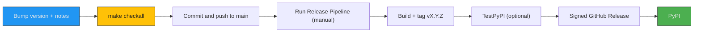

# Release Guide

How to cut a PAR LLAMA release: bump the version, update the release notes, verify, and publish to PyPI through GitHub Actions.

## Table of Contents

- [Overview](#overview)
- [Prerequisites](#prerequisites)
- [Bump the Version](#bump-the-version)
- [Update Release Notes](#update-release-notes)
- [Verify Locally](#verify-locally)
- [Publish with the Release Pipeline](#publish-with-the-release-pipeline)
- [Individual Workflows](#individual-workflows)
- [Local Publishing Targets](#local-publishing-targets)
- [Troubleshooting](#troubleshooting)

## Overview

Releases publish from CI, not from a developer machine. The `Release Pipeline` workflow builds the package, tags the commit, optionally stages it on TestPyPI, creates a signed GitHub Release, and publishes to PyPI using trusted publishing.



## Prerequisites

- Push access to `paulrobello/parllama` and permission to run workflows
- A clean `main` branch with CI green
- Only bump the version when a release is intended. Version changes are made deliberately, not as a side effect of other work

## Bump the Version

The single source of truth for the version is `__version__` in `src/parllama/__init__.py`. `pyproject.toml` reads it through `[tool.hatch.version]`, and the workflows read it with `from parllama import __version__`.

1. Edit `__version__` in `src/parllama/__init__.py`. The workflows reject anything that is not plain `X.Y.Z` (no `v` prefix, no pre-release suffix).
2. Confirm the value:

```bash
uv run python -c "from parllama import __version__; print(__version__)"
```

## Update Release Notes

Three places change with every version bump:

1. **`CHANGELOG.md`**: add a `## [X.Y.Z] - YYYY-MM-DD` section above the previous release, using the Keep a Changelog headings (`Added`, `Changed`, `Fixed`, `Security`, ...).
2. **README "What's new" section**: add a `### vX.Y.Z (Latest)` entry at the top and remove `(Latest)` from the previous entry.
3. **README table of contents**: under `* [What's new](#whats-new)`, add a link for the new version pointing at its `CHANGELOG.md` anchor. The list holds the newest 6 entries: 5 version links followed by a 6th entry labeled `older...` that links to `CHANGELOG.md`. Drop the oldest version link to keep that shape.

The CHANGELOG anchor for `## [0.9.2] - 2026-07-10` is `#092---2026-07-10`: the version with dots removed, then three hyphens, then the date.

## Verify Locally

Run the full quality gate. It formats, lints, type-checks, and runs the test suite, and it is the same command CI runs:

```bash
make checkall
```

Optionally build the distributions to confirm packaging works:

```bash
make package
```

`make package` cleans the build directories and runs `uv build`, writing the wheel and source distribution to `dist/`.

Commit the version bump and notes, then push to `main`. Wait for the `CI` workflow to pass.

## Publish with the Release Pipeline

1. Open the repository's **Actions** tab and select **Release Pipeline**.
2. Click **Run workflow** on `main`.
3. Leave **version** empty to use `__version__`, or enter an explicit `X.Y.Z`.
4. Leave **skip-testpypi** unchecked to stage on TestPyPI first, or check it to go straight to the release.

The pipeline (`.github/workflows/release-pipeline.yml`) runs these stages in order:

| Stage | What it does |
| --- | --- |
| Build and tag | Runs `make checkall` and `make package`, then creates and pushes tag `vX.Y.Z` if it does not already exist |
| TestPyPI | Publishes the built distributions to TestPyPI (skipped when **skip-testpypi** is checked) |
| GitHub Release | Signs the distributions with Sigstore, creates the `vX.Y.Z` release with generated notes, and uploads the files |
| PyPI | Publishes to PyPI with trusted publishing, after the GitHub Release succeeds |

Each stage halts the pipeline on failure. A summary job reports every stage's result in the workflow run summary.

Verify the release afterwards:

```bash
uv tool install parllama -U --force
parllama --version
```

## Individual Workflows

The pipeline stages also exist as separate, manually dispatched workflows for partial reruns. Each publishing workflow runs `make checkall` and `make package` before doing anything else; CI runs only `make checkall`.

| Workflow | File | Purpose |
| --- | --- | --- |
| CI | `.github/workflows/ci.yml` | Runs `make checkall` on every push and pull request to `main` |
| Publish to TestPyPI | `.github/workflows/publish-dev.yml` | Manual: publish to TestPyPI only |
| Release | `.github/workflows/release.yml` | Manual: create a signed GitHub Release only. It does not create the tag first |
| Publish to PyPI | `.github/workflows/publish.yml` | Manual: publish to PyPI only |

> **Note:** `publish.yml` also triggers when a GitHub Release is published, but in that case it only builds. The PyPI upload job runs only on a manual dispatch, so publishing a release in the GitHub UI does not reach PyPI on its own.

## Local Publishing Targets

The Makefile has `make test-publish` (TestPyPI) and `make publish` (PyPI) targets that run `uv publish` from a developer machine. Prefer the CI workflows: they use trusted publishing, sign the artifacts, and keep the tag, GitHub Release, and PyPI upload consistent.

> **Warning:** As of uv 0.12.1 both targets fail before uploading anything. The recipes pass a bare `--check-url`, which uv now requires a URL for, and `test-publish` names a `testpypi` index that the project does not configure. Use the workflows above until the targets are fixed.

## Troubleshooting

| Symptom | Cause | Fix |
| --- | --- | --- |
| `Invalid version format` in the build stage | `__version__` or the **version** input is not plain `X.Y.Z` | Correct the value and rerun |
| Tag already exists, pipeline continues | A previous run created `vX.Y.Z` | Expected on reruns; the tag is reused. Bump the version for a new release |
| PyPI stage skipped | GitHub Release stage failed, or TestPyPI failed | Fix the failing stage and rerun the pipeline |
| PyPI stage succeeds but nothing new is published | That version is already on PyPI; the pipeline uploads with `skip-existing` | PyPI versions are immutable; bump the version |
| `publish.yml` fails with a file-exists error | That version is already on PyPI; this workflow does not skip existing files | Bump the version |
